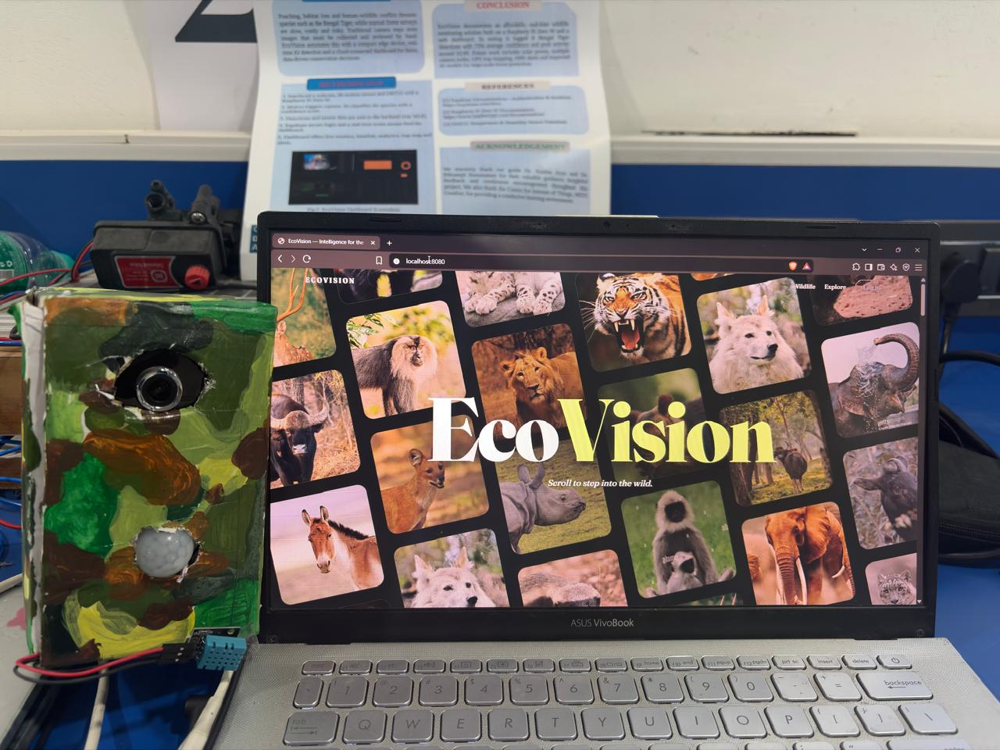

<div align="center">

# 🌿 EcoVision

### 🐅 AI-Powered Wildlife Camera Trap & Monitoring Dashboard

**AI • YOLO11 • Computer Vision • IoT • Raspberry Pi • FastAPI • Supabase**

<br/>



<br/><br/>


### 🌍 Making Wildlife Monitoring Smarter with Motion-Triggered AI Detection

</div>

---

# 📑 Table of Contents

- [About EcoVision](#-about-ecovision)
- [Problem Statement](#-problem-statement)
- [Our Solution](#-our-solution)
- [Key Features](#-key-features)
- [System Architecture](#-system-architecture)
- [Technology Stack](#-technology-stack)
- [Hardware Components](#-hardware-components)
- [AI & Machine Learning](#-ai--machine-learning)
- [How It Works](#-how-it-works)
- [Alert Severity Rules](#-alert-severity-rules)
- [Dashboard Modules](#-dashboard-modules)
- [Database & Cloud Integration](#-database--cloud-integration)
- [Project Structure](#-project-structure)
- [Installation & Setup](#-installation--setup)
- [Environment Configuration](#-environment-configuration)
- [Running the Project](#-running-the-project)
- [Known Limitations](#-known-limitations)
- [Future Enhancements](#-future-enhancements)
- [Developer Information](#-developer-information)

---

# 📖 About EcoVision

**EcoVision** is a wildlife monitoring system that automates animal detection using Artificial Intelligence, Computer Vision, and the Internet of Things (IoT).

Traditional camera traps produce large numbers of useless images triggered by wind, shadows, and vegetation, and reviewing them by hand takes a lot of time. EcoVision combines a PIR motion sensor, a Raspberry Pi Zero W, a USB camera, a DHT11 temperature and humidity sensor, and a YOLO11-based detection model to capture images, identify animals, and report them on a live dashboard.

Captured images are sent to a FastAPI backend for inference. Results are stored in Supabase and shown in a React dashboard with live detections, analytics, a trap map, and alerts.

---

# 🚨 Problem Statement

Traditional wildlife monitoring faces several challenges:

- Many false-triggered images from environmental movement.
- Manual inspection of captured photographs.
- Delayed identification of animal activity.
- Difficulty organizing wildlife observations.
- Limited centralized monitoring and analytics.

Poaching, habitat loss, and human-wildlife conflict also demand faster awareness of where and when animals, especially endangered species, are present.

---

# 💡 Our Solution

EcoVision introduces a motion-triggered, AI-assisted camera trap workflow:

1. The PIR sensor detects movement.
2. The Raspberry Pi Zero W captures an image with the USB camera and reads the DHT11 sensor.
3. The image and sensor data are sent over Wi-Fi to the FastAPI backend.
4. A YOLO11 model detects and classifies the animal.
5. Detections and images are stored in Supabase.
6. The React dashboard shows detections, analytics, and alerts in real time.

> **Note:** AI inference runs on the Windows-hosted backend, **not** on the Raspberry Pi Zero W. The Pi only handles sensing, capture, and upload.

---

# ✨ Key Features

- 🐅 AI-based wildlife detection with confidence scores
- 📸 PIR-triggered image capture
- 🌡️ Temperature and humidity logging (DHT11)
- 🖥️ Live monitoring dashboard with a real-time detection feed
- 📊 Analytics: species distribution, trends, activity summaries
- 🗺️ Camera trap map
- 🔔 Severity-based wildlife alerts
- ☁️ Supabase image storage and database
- ⚡ FastAPI backend with a live event stream
- 📅 Searchable detection history

---

# 🏗️ System Architecture

<div align="center">

```text
     WILDLIFE ENVIRONMENT
              |
              v
   PIR MOTION SENSOR + DHT11
              |
              v
     RASPBERRY PI ZERO W  <---- USB CAMERA
              |
        (HTTP over Wi-Fi)
              v
       FASTAPI BACKEND
        (Windows PC)
              |
              v
        YOLO11 MODEL
              |
              v
   DETECTION + CONFIDENCE
              |
              v
          SUPABASE
     (Storage + Database)
              |
              v
       REACT DASHBOARD
   (Live feed, analytics, alerts)
```

</div>

---

# 🛠️ Technology Stack

## Frontend

- React.js
- TypeScript
- TanStack Router
- Tailwind CSS
- Vite

## Backend

- Python
- FastAPI
- Uvicorn
- REST API and live event stream

## AI & Machine Learning

- YOLO11 (Ultralytics), custom-trained weights
- OpenCV
- Computer Vision / Deep Learning

## Database & Cloud

- Supabase (PostgreSQL + Storage)

## Hardware & IoT

- Raspberry Pi Zero W
- PIR Motion Sensor
- USB Camera
- DHT11 Temperature & Humidity Sensor

## Communication

- HTTP / REST (image and detection upload)
- MQTT (**TODO: describe its role, e.g. heartbeat and sensor telemetry, or remove this line if unused**)

---

# 🔩 Hardware Components

| Component | Purpose |
|---|---|
| **Raspberry Pi Zero W** | Edge controller: reads sensors, captures images, uploads to the backend |
| **PIR Motion Sensor** | Detects movement and triggers capture |
| **USB Camera** | Captures wildlife images |
| **DHT11 Sensor** | Records ambient temperature and humidity |
| **Camouflaged enclosure** | Houses the electronics for field deployment |

<div align="center">


</div>

---

# 🤖 AI & Machine Learning

EcoVision uses a **YOLO11** object detection model for wildlife image analysis.

### Model Details

> **TODO: fill in before publishing**

| Item | Value |
|---|---|
| Base model | YOLO11n (Ultralytics) |
| Training dataset | _name / source of dataset_ |
| Classes | _e.g. Bengal Tiger, ..._ |
| Weights file | _e.g. `backend/models/ecovision.pt`_ |
| Image size / epochs | _e.g. 640 / 100_ |

The stock YOLO11n weights are trained on COCO, which does not contain wildlife classes such as tigers, so EcoVision uses custom-trained weights.

### Model Workflow

1. Receive an image from the Raspberry Pi.
2. Run YOLO inference on the backend.
3. Identify supported animal classes.
4. Produce bounding boxes and confidence scores.
5. Store the result and notify the dashboard.

### Evaluation

> **TODO: add your numbers**

| Metric | Value |
|---|---|
| Precision | _…_ |
| Recall | _…_ |
| mAP@50 | _…_ |
| Test set size | _…_ |

Detection **confidence** shown on the dashboard (for example, around 75% on tiger detections) is the model's score for a single prediction. It is **not** the same as accuracy. Accuracy metrics should come only from validation against correctly labeled ground-truth data.

---

# ⚙️ How It Works

### Step 1 — Motion Detection
The PIR sensor continuously monitors the area.

### Step 2 — Image Capture
On motion, the Pi activates the USB camera, captures an image, and reads temperature and humidity.

### Step 3 — Image Transmission
The image and sensor readings are sent to the FastAPI backend over HTTP, authenticated with a device key.

### Step 4 — AI Inference
The backend runs the YOLO11 model on the image.

### Step 5 — Storage
Detections are saved to the Supabase database and images to the `wildlife-captures` bucket.

### Step 6 — Dashboard Visualization
The React dashboard receives live updates and shows detections, analytics, sensor data, and alerts.

---

# 🚦 Alert Severity Rules

> **TODO: replace with your actual rules**

| Severity | Condition |
|---|---|
| 🔴 Critical | _e.g. endangered or high-risk species (such as Bengal Tiger)_ |
| 🟠 High | _…_ |
| 🟡 Medium | _…_ |
| 🟢 Low | _…_ |

---

# 📊 Dashboard Modules

| Module | Description |
|---|---|
| **Live Monitor** | Camera feed, connection status, battery, last heartbeat, last motion, live detection list |
| **Activity Timeline** | Chronological history of detections |
| **Analytics** | Species distribution, detection trends, activity summaries |
| **Trap Map** | Camera trap locations and status |
| **Detections** | Species, confidence, timestamp, captured image |
| **Sensors** | Temperature, humidity, and device health |
| **Alerts** | Severity-based wildlife notifications |
| **Settings** | Device and application configuration |

---

# ☁️ Database & Cloud Integration

EcoVision uses Supabase for storage and data management.

- **Storage:** captured images in the `wildlife-captures` bucket.
- **Database:** structured detection and device records.

Typical detection record:

- Species name
- Confidence score
- Timestamp
- Device identifier
- Temperature and humidity (when available)
- Image storage reference

---

# 📁 Project Structure

```text
EcoVision/
│
├── backend/
│   ├── app/
│   │   ├── main.py
│   │   ├── inference.py
│   │   ├── models.py
│   │   ├── db.py
│   │   ├── alerts.py
│   │   ├── broadcast.py
│   │   └── mqtt_client.py
│   │
│   ├── database/
│   │   └── schema.sql
│   │
│   ├── requirements.txt
│   └── test_inference.py
│
├── edge/
│   └── ecovision_edge.py
│
├── public/
│   ├── videos/
│   ├── hero.jpg
│   └── favicon.ico
│
├── src/
│   ├── assets/
│   ├── components/
│   ├── hooks/
│   ├── lib/
│   └── routes/
│
├── .env.example
├── .gitignore
├── package.json
├── vite.config.ts
└── README.md
```

---

# 🚀 Installation & Setup

## 1. Clone the Repository

```bash
git clone https://github.com/Kartiksinghparihar/EcoVision.git
cd EcoVision
```

## 2. Frontend Setup

```bash
npm install
```

Copy `.env.example` to `.env` and fill in your values.

## 3. Backend Setup

```bash
cd backend
python -m venv .venv
```

Activate the environment (Windows PowerShell):

```powershell
.venv\Scripts\Activate.ps1
```

Install dependencies:

```bash
pip install -r requirements.txt
```

## 4. Edge Device Setup (Raspberry Pi Zero W)

Copy `edge/ecovision_edge.py` to the Pi (for example `/home/zerow/ecovision`) and install the required Python libraries for the camera, PIR, and DHT11 sensors.

---

# 🔐 Environment Configuration

### Frontend (`.env`)

```env
VITE_SUPABASE_URL=your_supabase_project_url
VITE_SUPABASE_ANON_KEY=your_supabase_anon_key
```

### Backend (`backend/.env`)

```env
SUPABASE_URL=your_supabase_project_url
SUPABASE_SERVICE_KEY=your_service_role_key
MODEL_PATH=path/to/your_weights.pt
EDGE_API_KEY=your_edge_device_key
```

### Edge Device

Set the backend URL and the same `EDGE_API_KEY` in `ecovision_edge.py` (or its config).

> **Important:** Never commit real API keys, passwords, or Supabase service-role credentials to GitHub.

---

# ▶️ Running the Project

## Start the Backend

From the `backend` directory:

```powershell
uvicorn app.main:app --host 0.0.0.0 --port 8000 --reload
```

Health check: `http://localhost:8000/health`

## Start the Frontend

From the project root:

```bash
npm run dev
```

Open the app at `http://localhost:8080` (**TODO: confirm the port in `vite.config.ts`**).

## Start the Raspberry Pi Edge Device

```bash
cd /home/zerow/ecovision
python3 ecovision_edge.py
```

Make sure the Pi and the backend computer are on the same network and the backend URL is reachable.

---

# ⚠️ Known Limitations

- Inference runs on a PC, so the system needs a reachable backend and cannot detect animals fully offline.
- The Raspberry Pi Zero W has limited power and Wi-Fi range, which affects field deployment.
- The model supports only the classes it was trained on.
- The DHT11 has limited accuracy (about ±2 °C and ±5% RH).
- Detection confidence is not a measure of accuracy (see [Evaluation](#evaluation)).

---

# 🌍 Future Enhancements

- On-device or edge-accelerated inference
- Support for additional species
- Solar-powered, battery-monitored deployment
- GPS-based trap tracking
- Multi-camera support
- Historical wildlife movement analysis
- Automated conservation alerts (SMS / email)

---

# 👨‍💻 Developer Information

<div align="center">

| Kartik Singh Parihar | Khyati Sahu |
|:---:|:---:|
| **IoT & Full Stack Development** | **AI/ML & IoT Development** |
| [GitHub](https://github.com/Kartiksinghparihar) | [GitHub](https://github.com/misspresident-codes) |
| [LinkedIn](https://www.linkedin.com/in/kartik-singh-parihar-973518329/) | [LinkedIn](https://www.linkedin.com/in/khyati-sahu-178506380/) |

**Institution:** Madhav Institute of Technology & Science (MITS), Gwalior, Madhya Pradesh

**Project:** EcoVision — AI-Powered Wildlife Camera Trap & Monitoring Dashboard

</div>

---

# ⭐ Support

If you like EcoVision, please consider giving the repository a ⭐ on GitHub.

<div align="center">

### 🌿 Built with ❤️ for Wildlife Conservation

**EcoVision — Observe. Detect. Protect.** 🐅

[GitHub Repository](https://github.com/Kartiksinghparihar/EcoVision)

</div>
